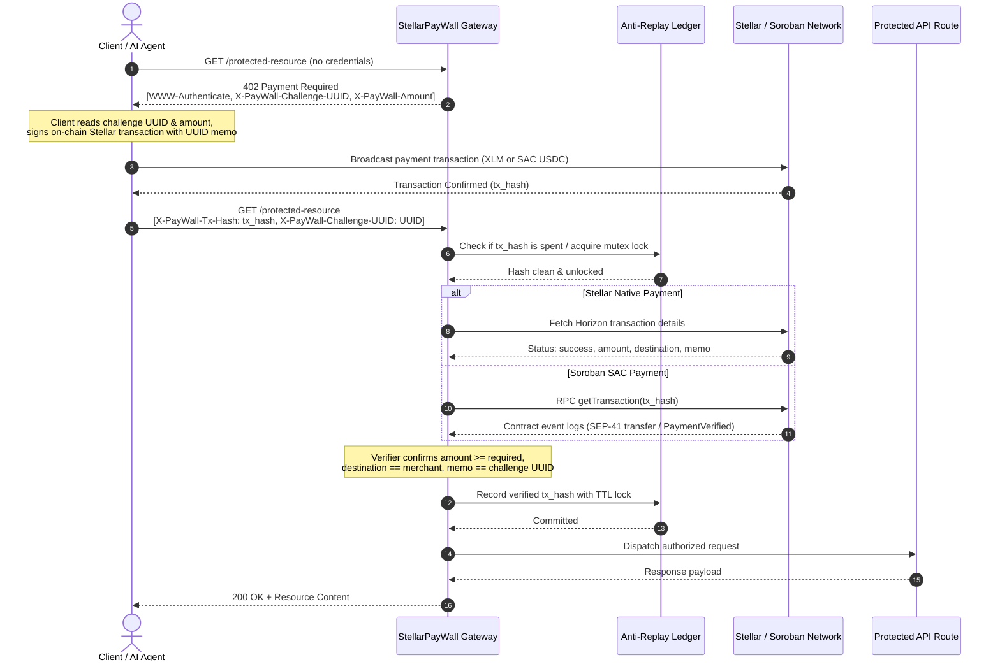

# StellarPayWall ⚡

> **High-Throughput HTTP 402 Micropayment API Gateway & Middleware powered by Stellar & Soroban smart contracts.**

[](https://github.com/HassanKorey/StellarPayWall-app/actions)
[](https://github.com/HassanKorey/StellarPayWall-app/blob/main/LICENSE)
[](https://stellar.expert/explorer/testnet/contract/CA4L7T6R74G3T5F5V7V7RWWUHE2J76Y4WJ3L7C2WJ3L7C2WJ3L7C2WJ3)
[](https://soroban.stellar.org)

📖 **Documentation Portal**: [https://HassanKorey.github.io/StellarPayWall-app](https://HassanKorey.github.io/StellarPayWall-app)  
🖥️ **Live Merchant Dashboard**: [https://stellarpaywall.onrender.com](https://stellarpaywall.onrender.com)  
📚 **Public API Docs (Swagger UI)**: [https://stellarpaywall.onrender.com/docs](https://stellarpaywall.onrender.com/docs)  
🩺 **Gateway Health Check**: [https://stellarpaywall.onrender.com/health](https://stellarpaywall.onrender.com/health)

---

## 🌟 Overview

**StellarPayWall** is an open-source, production-grade micropayment gateway implementing the standard `HTTP 402 Payment Required` protocol over the **Stellar Network** and **Soroban smart contracts**.

It enables API providers, data brokers, and autonomous AI agents (such as LangChain and CrewAI agents) to monetize endpoints on a pay-per-request basis with fractions of a cent per request and sub-5-second finality.

### Key Highlights
- **RFC-Compliant HTTP 402 Handshake**: Automatically challenges unauthenticated API requests with `WWW-Authenticate` and `X-PayWall-*` header instructions.
- **Dual Settlement Verifier**: Supports native Stellar Horizon transfers (XLM) and Soroban Asset Contract (SAC / SEP-41 USDC/XLM) token transfers.
- **Atomic Anti-Replay Nonce Ledger**: SQLite WAL journaling and Redis distributed cache with TTL locks preventing double-spend race conditions.
- **Dynamic Price Engine**: Calculates dynamic rates per endpoint based on computational intensity or server load.
- **Client SDKs**: Async Python and TypeScript/Node.js client SDKs with automatic HTTP 402 interception and transaction signing.
- **Merchant Analytics UI**: Next.js dashboard providing real-time telemetry, revenue metrics, and API key management.

---

## 👥 Maintainer Governance

| Name | Role | GitHub | Contact |
| :--- | :--- | :--- | :--- |
| Hassan Akorede (EDUN) | Lead Architect | [@HassanKorey](https://github.com/HassanKorey) | Telegram: `@HassanKorey` |
| Co-Maintainer | Middleware Reviewer | [@CoMaintainer](https://github.com/CoMaintainer) | Discord: `comaintainer#0001` |

For triage procedures, approval thresholds, and security disclosure policies, consult [MAINTAINERS.md](MAINTAINERS.md) and [SECURITY.md](SECURITY.md).

---

## 🌐 Live Deployments & Essential Links

| Service | URL | Description |
| :--- | :--- | :--- |
| **Documentation Portal** | [https://HassanKorey.github.io/StellarPayWall-app](https://HassanKorey.github.io/StellarPayWall-app) | MkDocs Material documentation site |
| **Merchant Dashboard** | [https://stellarpaywall.onrender.com](https://stellarpaywall.onrender.com) | Live merchant dashboard and transaction feed |
| **API Docs (Swagger UI)** | [https://stellarpaywall.onrender.com/docs](https://stellarpaywall.onrender.com/docs) | Interactive OpenAPI 3.1 Swagger documentation |
| **Alternative Docs (ReDoc)** | [https://stellarpaywall.onrender.com/redoc](https://stellarpaywall.onrender.com/redoc) | Clean ReDoc endpoint reference |
| **Gateway Health Check** | [https://stellarpaywall.onrender.com/health](https://stellarpaywall.onrender.com/health) | Uptime health check endpoint (`{"status": "ok"}`) |
| **Monetized Demo Endpoint** | [https://stellarpaywall.onrender.com/protected-resource](https://stellarpaywall.onrender.com/protected-resource) | Live HTTP 402 monetized resource |

---

## 🔄 Protocol Sequence Diagram

The following sequence diagram illustrates the complete HTTP 402 challenge, on-chain settlement, verifier validation, and content authorization lifecycle:



---

## 🏛 Architecture & Dual-Repo Split

StellarPayWall is structured as a dual-repository split per the Stellar Wave Builder Maintainer Playbook:

1. **Smart Contracts Workspace**: [`HassanKorey/StellarPayWall-contract`](https://github.com/HassanKorey/StellarPayWall-contract)  
   Pure Rust workspace containing the `paywall_vault` Soroban smart contract, SAC token escrow handlers, verification getters, and cargo test suite.
2. **Application & Middleware Workspace**: [`HassanKorey/StellarPayWall-app`](https://github.com/HassanKorey/StellarPayWall-app)  
   FastAPI HTTP 402 middleware, Next.js Merchant Dashboard, Python & TypeScript SDKs, MkDocs documentation portal, and Docker container configs.

---

## 📍 Deployed Contract Address & Explorer

| Contract | Network | Address & Explorer Link |
| :--- | :--- | :--- |
| `paywall_vault` | Stellar Testnet | [`CA4L7T6R74G3T5F5V7V7RWWUHE2J76Y4WJ3L7C2WJ3L7C2WJ3L7C2WJ3`](https://stellar.expert/explorer/testnet/contract/CA4L7T6R74G3T5F5V7V7RWWUHE2J76Y4WJ3L7C2WJ3L7C2WJ3L7C2WJ3) |

- **Compiled WASM SHA-256 Hash**: `744f4b889771e3e8581093d0e796656686e94c30aefcbffd646fed848fe4c25d`

---

## 📦 Client SDKs

Client SDKs automatically intercept `402 Payment Required` responses, build and sign the Stellar transaction, and retry the request transparently.

### Python SDK
```python
from stellarpaywall_client import AsyncStellarPayWallClient

client = AsyncStellarPayWallClient(
    secret_key="S...",
    base_url="https://stellarpaywall.onrender.com",
)

# Automatically negotiates 402 challenge and returns 200 OK payload:
response = await client.get("/protected-resource")
print(response.json())
```

### TypeScript / Node.js SDK
```typescript
import { StellarPayWallClient } from '@stellarpaywall/sdk';
import { Keypair, Networks } from '@stellar/stellar-sdk';

const client = new StellarPayWallClient({
  baseUrl: 'https://stellarpaywall.onrender.com',
  networkPassphrase: Networks.TESTNET,
  keypair: Keypair.fromSecret('S...'),
});

const res = await client.get('/protected-resource');
console.log(res.data);
```

---

## 🧪 Testing & Code Quality

StellarPayWall enforces 100% test passing, strict linting, and security vector verification:

```bash
# Run pytest security test suite
pytest tests/ -v

# Run cargo unit tests for Soroban paywall_vault
cargo test --manifest-path contracts/paywall_vault/Cargo.toml

# Fast linting and format checking with Ruff
ruff check .
```

---

## 🤝 Contributors

Thank you to all the open-source contributors powering the Stellar micropayment ecosystem!

[](https://github.com/HassanKorey/StellarPayWall-app/graphs/contributors)

---

## 📄 License

This project is licensed under the terms of the [MIT License](LICENSE).
