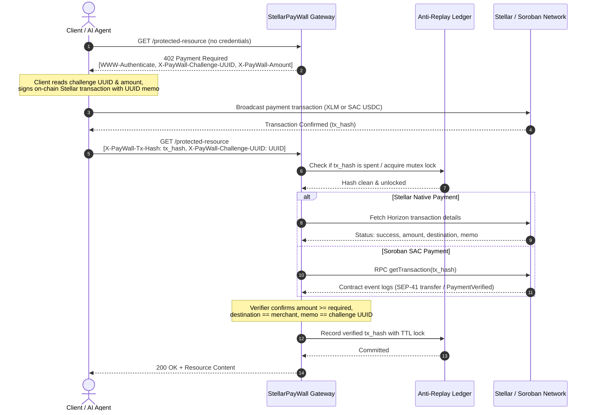

# HTTP 402 Micropayment Protocol 📜

The `HTTP 402 Payment Required` status code is an HTTP standard reserved for digital cash systems. StellarPayWall realizes this standard on the Stellar blockchain, turning any API endpoint into a pay-per-use monetized asset.

---

## 🔄 Protocol Sequence Diagram



---

## 📋 Challenge Specification

When an endpoint protected by `HTTP402Middleware` receives an unauthenticated request, it responds with:

### Response Headers
| Header | Description | Example |
| :--- | :--- | :--- |
| `WWW-Authenticate` | RFC-compliant authentication challenge string | `Stellar asset="XLM", amount="0.05", destination="merchant_address", challenge="b3a9c2..."` |
| `X-PayWall-Amount` | Required payment amount in units of the asset | `0.05` |
| `X-PayWall-Asset` | Accepted asset (`XLM`, `USDC`, or SAC Contract ID) | `XLM` |
| `X-PayWall-Destination` | Merchant Stellar public key or contract address | `GBBD47IF6LWK7P7MDEVSCWR7DPUWV3NY3DTQEVFL4NAT4AQH3ZLLFLA5` |
| `X-PayWall-Challenge-UUID` | Unique cryptographic nonce tying payment to request | `d7a5b3e2-89f4-4e2b-a01c-72149b18204d` |
| `X-PayWall-Expires-In` | Challenge validity window in seconds | `300` |

### Response Body
```json
{
  "detail": "Payment Required"
}
```

---

## 💳 Payment Construction

Clients have two settlement paths:

### Option A: Stellar Native Horizon Payment (XLM)
1. Build a `PaymentOperation` transferring at least `X-PayWall-Amount` to `X-PayWall-Destination`.
2. Attach the `X-PayWall-Challenge-UUID` as `Memo.text(challenge_uuid)`.
3. Sign and broadcast to the Stellar Network.
4. Obtain the transaction hash `tx_hash`.

### Option B: Soroban SAC Smart Contract Invocation (`paywall_vault`)
1. Invoke the `pay_for_resource` contract function:
   ```rust
   pay_for_resource(
       payer: Address,
       request_id: Symbol(challenge_uuid),
       amount: i128(scaled_amount)
   )
   ```
2. The contract transfers the SAC tokens into escrow and emits a `PaymentVerified` event with topic `(PaymentVerified, request_id)` and data `amount`.
3. Obtain transaction hash `tx_hash`.

---

## 🔑 Request Authorization Submission

Retry the request including the proof-of-payment headers:

```http
GET /protected-resource HTTP/1.1
Host: stellarpaywall.onrender.com
X-PayWall-Tx-Hash: 4b29f0e1c2a8d3e...
X-PayWall-Challenge-UUID: d7a5b3e2-89f4-4e2b-a01c-72149b18204d
```

### Protocol Status Codes
| Status Code | Meaning | Cause |
| :--- | :--- | :--- |
| **`200 OK`** | Access Granted | Payment verified, destination matched, memo validated, hash committed to ledger. |
| **`402 Payment Required`** | Challenge / Invalid Payment | No payment provided, underpayment, wrong destination, wrong asset, or memo mismatch. |
| **`400 Bad Request`** | Replay Attack | Transaction hash was already spent or is currently in-flight. |
